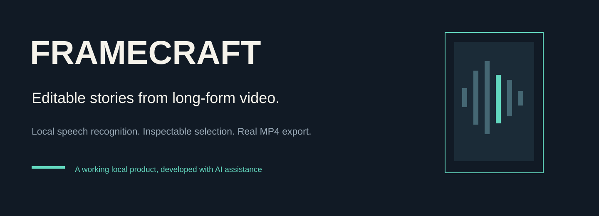
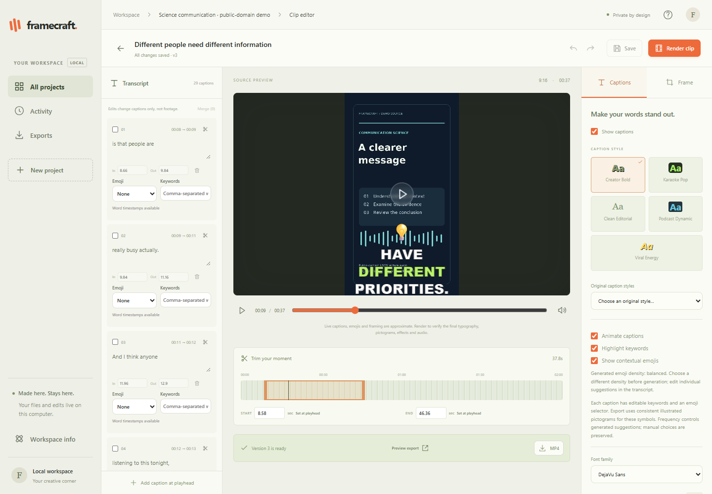
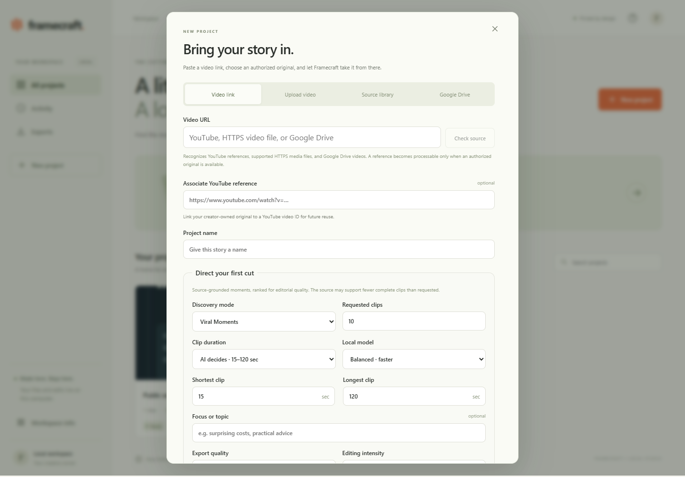
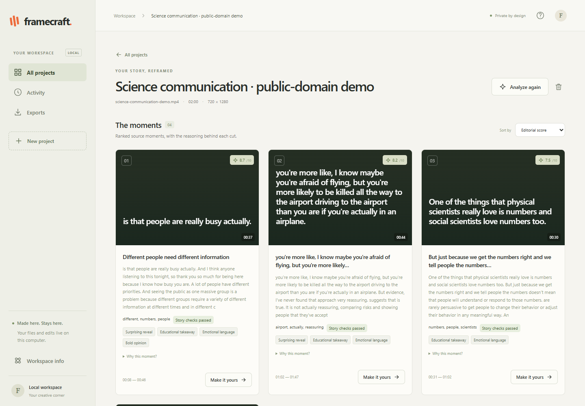
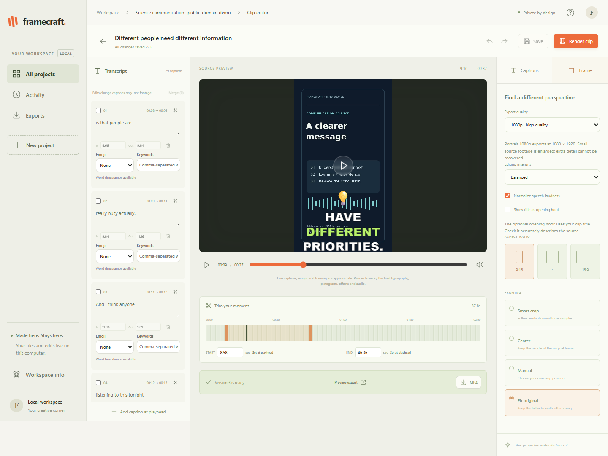
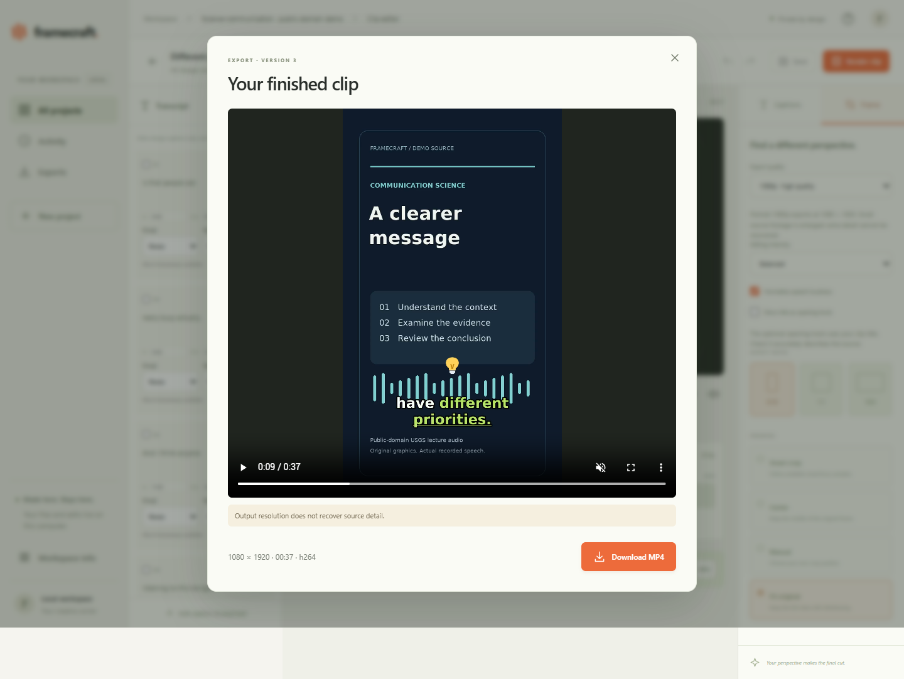
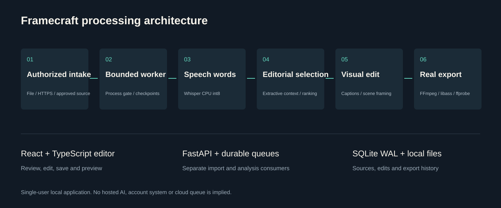

# Framecraft

**Turn long-form video into editable short-form stories.**



Framecraft is a working local video-clipping application. Import an authorized recording, review ranked moments, correct captions and framing, then export a real MP4. Speech recognition and media analysis run locally without mandatory paid AI credentials.

Built through product research, explicit acceptance criteria, iterative testing and materially AI-assisted implementation. This is an early-stage single-user product, not a production SaaS or a claim of commercial traction.

**Explore:** [Pitch deck](portfolio/pitch-deck/Framecraft_Startup_Pitch_Deck_2026.pdf) · [Engineering case study](portfolio/case-study/Framecraft_Engineering_Case_Study_2026.pdf) · [One-page brief](portfolio/one-pager/Framecraft_One_Page_Overview.pdf) · [Architecture](docs/ARCHITECTURE.md)

## See the actual product



[Watch or download the 37.8-second rendered preview](assets/product/framecraft-real-export-muted.mp4). The public preview is intentionally silent. Its captions and pictograms come from the actual renderer, using public-domain speech for recognition and original illustrative graphics. It is not a customer recording or a mock interface. The source graphics are 720 × 1280, rendered on a 1080 × 1920 canvas. [Full asset provenance](assets/product/PROVENANCE.md).

<details><summary>More genuine product captures</summary>

| Import and generation | Ranked source moments |
|---|---|
|  |  |

| Framing and output settings | Actual export preview |
|---|---|
|  |  |

</details>

## What works

| Capability | Implemented behavior | Current boundary |
|---|---|---|
| Authorized media intake | File upload, supported direct HTTPS files, durable imports, reusable source originals | A YouTube metadata reference alone is not downloadable media |
| Local transcription | faster-whisper CPU int8 with word estimates, bounded audio windows and saved checkpoints | Recognition errors and names need review; no forced alignment |
| Editorial selection | Extractive topic/question context, complete-answer checks, six evidence dimensions and diverse reranking | Lexical/acoustic heuristics, not an LLM or virality prediction |
| Creation controls | Discovery modes, duration, clip count, lexical custom prompt and local model mode | Prompts filter source evidence; arbitrary visual reasoning is unsupported |
| Captions and editing | Five newer styles, retained legacy styles, active words, keywords, editable vector pictograms, trim and undo/redo | Live source overlays approximate typography; rendered preview is authoritative |
| Framing | OpenCV scene/face samples, bounded motion, safe fit and manual crop | No reliable active-speaker attribution or stacked layout |
| Export and persistence | Real 720p/1080p H.264/AAC MP4, ZIP, versioned edits and export history | Upscaling does not recover source detail; no 4K guarantee |
| Google Drive adapter | OAuth code flow, picker and authorized download implementation | Live account authorization remains unverified |

## The workflow

1. Import a recording you own or have permission to process.
2. Set discovery, duration, local model and caption preferences.
3. Inspect candidate timestamps, story checks and ranking evidence.
4. Correct names, text, timing, keywords, pictograms and framing.
5. Save, render, preview the encoded result and download MP4 or ZIP.

Reanalysis retains previous selections and saved edits. A source-library association can reuse a creator-stored original without uploading it again. Framecraft does not scrape YouTube streams or bypass source restrictions.

## Architecture



React and TypeScript provide the editor. FastAPI serves the API and compiled interface. Separate durable import and analysis consumers coordinate validated sources and bounded workers. SQLite WAL schema 2 stores projects, jobs, source associations, edits and export history. FFmpeg/libass renders the canonical saved edit; ffprobe validates the resulting file.

The interesting engineering is in the boundaries: input validation before project publication, chunk ownership across ASR seams, gated worker containment, resumable jobs, source-grounded ranking, and persistent edits that remain authoritative at render time. [Architecture and module map](docs/ARCHITECTURE.md) · [API guide](docs/API.md).

## Technology

Python 3.12+, FastAPI, Pydantic, SQLAlchemy, SQLite WAL, faster-whisper/CTranslate2, OpenCV, NumPy, Pillow, FFmpeg/libass/ffprobe, React 19, TypeScript and Vite. Windows is the verified platform. There is no Redis, PostgreSQL, hosted language-model service or required paid key.

## Run on Windows

Install **Python 3.12+** and **Node.js 22.12+**, then clone this repository:

```powershell
git clone https://github.com/KevBrad/framecraft-ai.git
Set-Location framecraft-ai
powershell -ExecutionPolicy Bypass -File .\scripts\setup.ps1
powershell -ExecutionPolicy Bypass -File .\scripts\start.ps1
```

Open **http://127.0.0.1:8000**. The setup script creates `.venv`, installs pinned requirements, builds the frontend and obtains external FFmpeg tools when needed. Whisper weights download on first analysis. Review the [Windows setup and troubleshooting guide](docs/SETUP.md) for requirements, optional quality-model preparation and storage. No private project data or model weights ship in this repository.

## AI and media pipeline

- Normalize to 16 kHz mono PCM, then read 30-second cores with two seconds of context per side.
- Assign recognized words to the core containing their timestamp midpoint and save completed cores atomically.
- Build timestamped extractive units and a whole-source topic/question map.
- Find candidate hooks, retain nearby question/answer context and later contrasts, score evidence and filter overlap.
- Sample low-resolution scenes/faces, choose a safe composition, and save editable captions and framing.
- Render the saved specification in an isolated worker, then validate codec, dimensions, duration and stream timing.

Balanced uses `tiny.en` with beam 3. Quality uses a cached multilingual `base` model with beam 5; an unavailable quality cache falls back explicitly. Both tested profiles use CPU int8 with bounded concurrency. [Engineering decisions](docs/ENGINEERING.md).

## Verified testing and measured performance

**29 October 2026:** 290 tests plus four caption-layout subtests passed in 78.73 seconds, with no skips. A fresh TypeScript/Vite build passed. Database records and retained original-file hashes remained unchanged. The sanitized source's lightweight CI command separately passed 177 tests, with two media tests explicitly excluded. These counts are technical validation, not customer traction.

Retained release evidence from **23 October 2026**, re-inspected during publication:

| Continuous source | Upload/import plus analysis | Timestamped words | Peak sampled private memory |
|---|---:|---:|---:|
| 13 min 29 s | 101.20 s | 2,750 | 1,341 MiB |
| 15 min | 104.08 s | 2,131 | 1,309 MiB |
| 60 min | 311.62 s | 9,224 | 1,397 MiB |

Measured on one Intel i7-11800H CPU workstation. Times include validation, ASR, selection and framing, but exclude later export. Memory sampling is not an exact Job Object high-water counter. The long runs and 20 historical browser workflow checks were **not rerun as long-form tests during publication**. Fresh safe-demo captures exercised actual analysis, editing and export. No cross-product speed or quality superiority is implied. [Full verified results and scope](docs/VERIFIED_RESULTS.md).

## Tests and CI

```powershell
.\.venv\Scripts\python.exe scripts\prepare_fixture.py
.\.venv\Scripts\python.exe scripts\prepare_face_fixture.py
.\.venv\Scripts\python.exe -m pytest backend tests -q
npm.cmd --prefix frontend run build
```

The default [source-check workflow](.github/workflows/ci.yml) runs TypeScript/build and Windows logic/intake/security tests without model downloads or private media. The [manual media workflow](.github/workflows/media-integration.yml) prepares documented public fixtures and runs actual ASR/render tests. Hosted CI status is reported by GitHub; local test results are not presented as a fabricated green badge. [Test guide](docs/TESTING.md).

## Development milestones

| Recorded milestone | Engineering focus |
|---|---|
| 22 October 2026 | Memory-safe transcription, resumable processing and long-video repair |
| 23 October 2026 | Explainable story selection, caption/director/editor integration and 1080p validation |
| 29 October 2026 | Publication audit, fresh tests, safe product captures and portfolio materials |

## Known limitations

Highlight selection remains partly heuristic. ASR and factual quotations need human review. Forced alignment, reliable speaker attribution, broad multimodal reasoning, intelligent punch-ins and transcript-based footage removal are not implemented. Live Drive OAuth still needs configured credentials and consent. Docker/Linux and public multi-user hosting are unverified. The local loopback service is not a hardened SaaS boundary. [Security](SECURITY.md) · [Limitations and roadmap](docs/ROADMAP.md).

## Portfolio and next steps

- [Editable startup pitch deck](portfolio/pitch-deck/Framecraft_Startup_Pitch_Deck_2026.pptx) and [PDF](portfolio/pitch-deck/Framecraft_Startup_Pitch_Deck_2026.pdf)
- [Six-page engineering case study](portfolio/case-study/Framecraft_Engineering_Case_Study_2026.pdf)
- [One-page product overview](portfolio/one-pager/Framecraft_One_Page_Overview.pdf)
- [Research sources and claim classifications](docs/RESEARCH_SOURCES.md)
- [Publication security audit](docs/PUBLICATION_SECURITY_AUDIT.md)

The next product questions are highlight accuracy, editing effort and willingness to pay. Proposed creator trials, subscription ideas and a hosted pilot remain hypotheses. No revenue, customer, fundraising or competitive-superiority claim is made.

## Credits and source availability

Project direction, requirements, research and iterative acceptance testing were led by **[KevBrad](https://github.com/KevBrad)**, with substantial AI assistance in implementation and debugging. This project does not claim that every line was handwritten independently.

**No project-wide open-source license has been selected.** This is publicly visible source for inspection and portfolio review, not a newly invented permissive grant. Third-party dependencies, fonts and fixtures retain their own licenses. See [source-availability notice](SOURCE_AVAILABLE_NOTICE.md), [third-party notices](THIRD_PARTY_NOTICES.md), and [asset provenance](assets/product/PROVENANCE.md).
