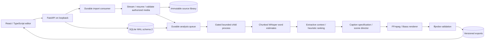

# Architecture

Verified against application source on 29 October 2026. This is one local single-user application, not a distributed cloud service.

## Components

| Module | Responsibility |
|---|---|
| `main.py`, `schemas.py` | Request validation, upload, project/edit/render endpoints and finite typed contracts |
| `database.py` | SQLite WAL schema 2 and transactional publication of persisted states |
| `providers.py`, `import_routes.py` | Unified source discovery, authorized download plans and connection APIs |
| `import_transport.py`, `import_service.py`, `import_probe.py` | Bounded/resumable transfer, progress, safe addressing/redirects, contained validation and automatic queueing |
| `drive.py`, `secrets.py` | Desktop OAuth/PKCE, official Drive APIs and encrypted per-user secret handling |
| `media_library.py` | Content-addressed originals and explicit reference associations |
| `worker.py`, `task_runner.py`, `resources.py` | Durable job transitions, execution gate, Windows Job Object and timeout/disk controls |
| `pipeline.py`, `model_profiles.py` | Probe, normalized audio, bounded ASR/checkpoints, cache and local profiles |
| `editorial.py` | Extractive topic/question map, source-grounded intervals, weighted evidence and reranking |
| `caption_engine.py`, `director.py` | Canonical caption events, original pictograms and bounded scene/face composition |
| `archives.py` | Streaming ZIP of existing validated MP4 exports |

## Persistence and recovery

Projects, clips, jobs, exports, imports, media sources and reference links use stable identities. Sources and models stay in ignored local storage. Completed speech cores survive retries. Matching candidates preserve saved clip edits. A new successful generation marks older selections as previous rather than deleting them. Render jobs store edit snapshots; older exports stay accessible. Registry backfill preserves explicit source links and timestamps.

## Processing boundaries

The default Windows child budget is 2,048 MiB. Workers wait for containment before media execution. ASR reads 30-second cores with two seconds of context. Word midpoint ownership avoids seam duplication. Extractive units cover roughly 90 seconds; this is not an unbounded model prompt. Visual sampling caps work dimensions at 640 pixels and samples at 2,400. ASS limits event count/bytes and measures safe caption layout. The renderer validates real H.264/AAC output.

The browser's fast source overlay is approximate. A rendered MP4 is the authoritative preview. The system has no reliable speaker identity, LLM multimodal reasoning, account tenancy or production cloud scheduler.
