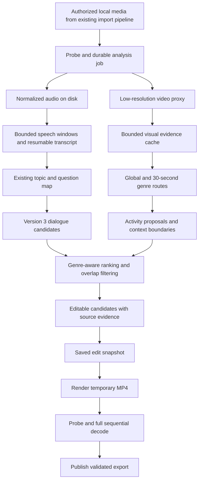

# Framecraft v4: implemented architecture and decisions

Implementation reviewed 12 November 2026 (Asia/Kuala_Lumpur). This document describes the code in the existing application, not a proposed replacement. Measured results and release checks are recorded separately in `TEST_REPORT.md` and the v4 release report.

## Release boundary

The new route is **experimental and opt-in**: `AnalysisSettings.analysis_version=4`, with evidence version `multimodal-evidence-v4.2`. Version 3 remains the default speech engine; the legacy version 1 API option is retained. The existing React/TypeScript frontend, FastAPI service, SQLite database, source registry, import adapters, durable queue, editor, and FFmpeg renderer remain in place.

`content_genre` accepts `auto`, `general`, `podcast`, `gaming`, `cinematic`, `education`, `sports`, `comedy`, and `visual`. These are editorial routing choices, not proof of a trained semantic classifier for every genre. Automatic routing uses recognized terms, speech coverage, and measured image activity. A silent game can therefore be labeled `visual`; selecting `gaming` is explicitly recorded as a user override. Confidence values are heuristic and uncalibrated. A manual choice is not presented as model confidence.

## Processing flow



Ingestion still requires accessible, authorized media. YouTube metadata alone does not become downloadable media through this upgrade. Existing direct-media validation, source reuse, Drive connection configuration, and import progress are preserved. No stream scraper, new cloud dependency, or fabricated OAuth credential was added.

### Audio and failure semantics

FFmpeg extracts 16 kHz mono PCM to disk. The repaired speech path reads a 30-second core by default, with two seconds of context on either side; the configurable core range remains 10–60 seconds. A recognized word belongs to the core containing its midpoint. Completed cores are written atomically to `transcription-progress.json` with source/audio, model, chunk-size, and beam-size fingerprints. Retry resumes matching completed cores. Audio tensors are bounded per window; the retained transcript and its JSON naturally grow with recording length.

Version 4 distinguishes three legitimate empty-transcript states: no audio stream, audio below the silence threshold, and a completed recognizer run with no reliable speech. Those states can continue to visual selection without invented dialogue or captions. `NoSpeechError` identifies the last case. A model-loading error, allocation failure, decoder failure, or cancellation remains an error; it is not relabeled as a successful silent-video analysis.

The shared `analysis-cache.json` retains schema 3 for speech, audio energy, topic maps, and compatible framing. Styling changes continue to render from saved edits without rerunning recognition. Source/proxy preprocessing uses temporary files and atomic replacement. Model profiles remain local CPU/int8; this release does not claim a new GPU or large-model inference path.

### Visual evidence and cache limits

`backend/intelligence.py` measures the existing 8 fps, at-most-640-pixel-wide proxy. OpenCV decodes it sequentially and retrieves scheduled frames. Measurement frames are at most 320×180 pixels. Normal sampling is every 0.5 seconds; longer sources increase the interval to keep at most 6,000 samples. The accepted duration range ends at 24 hours, an input bound rather than evidence that 24-hour media has been tested. Visual analysis has a 120–1,800 second deadline, scaled by source duration.

Each sample contains time, grayscale image change, HSV histogram distance, brightness, detail, and a possible-cut flag. These observations do not identify kills, goals, jokes, emotions, people, or plot points. Camera motion, compression, slides, menus, and transitions can produce the same signals.

`multimodal-visual-v4.json` is reusable across editorial settings. Its fingerprint includes the algorithm version, source/proxy size and modification time, duration, and sample limit. Cached files larger than 8 MiB are not loaded. Validation rejects nonfinite values, duplicate/out-of-range times, incomplete timeline tails, and incompatible fingerprints. Writes use atomic replacement. This is local cache invalidation, not a cryptographic identity mechanism for arbitrary external files.

The returned project metadata contains version, global genre, 30-second region routes, sample count, and diagnostics. Raw measurement arrays remain in the local analysis artifact. The 30-second routes allow different regions of mixed footage to influence candidate behavior, but do not constitute learned scene or narrative segmentation.

### Discovery, boundaries, and ranking

Dialogue candidates reuse the established editorial engine and recognized speech boundaries. Education and comedy routes change the existing discovery objective. Visual genres apply explicit, modest image-activity weights to dialogue ranking; speech-oriented routes retain their established criteria.

Additional visual proposals require measured movement, usable brightness/detail, and source-relative peaks. Cut-only spikes receive reduced weight. Gaming, sports, and visual activity routes also require sustained nearby movement, reducing isolated menu/slide-transition proposals. Candidate anchors are separated, capped at 80, and limited by the requested count. Overlapping final candidates are filtered. The selector can return fewer clips than requested; a static source or unsupported duration can yield an actionable no-candidate error.

Context windows include material before and after an activity peak. Cinematic proposals can expand to surrounding detected cuts when the duration limit allows. Visual proposals that overlap speech retain whole recognized units when possible; otherwise the proposal is rejected. Custom prompts and topic filters remain grounded in recognized dialogue; arbitrary visual clips are not returned as matches to a text request.

Version 4.2 adds a conservative inactive-tail check for gaming, sports, and visual routes with sparse speech. Following a genuinely active anchor, at least three seconds of sufficiently low image change can shorten the ending while retaining a one-second closing beat and respecting minimum duration. It never discards recognized speech in that tail and does not run for cinematic pauses. This is a measurable activity heuristic, not menu detection or understanding of a game's result. Source-specific timestamps and filenames are not used as rules.

Each candidate stores algorithm version, route, speech/visual/mixed basis, observed signal timestamps, limitations, and a boundary note. Scores remain ranking aids rather than virality probabilities. The frontend exposes evidence and uncertainty alongside the editable clip.

## Editing, rendering, and persistence

Gaming, cinematic, sports, visual, and educational routes prefer **Fit** framing to retain the original image, with restrained captions, no automatic emojis, and no decorative opening hook. Visual-only clips have no fabricated captions. Cinematic and activity routes preserve source audio dynamics by disabling automatic normalization in their default edit. The user can change these decisions in the existing editor.

Fit preserves composition and HUD/slide content but can leave large bars in a portrait canvas. For landscape gameplay, detailed demonstrations, and slides, **16:9 with Fit** is often the more readable export choice. Portrait Fit is a conservative preservation option, not semantic HUD relocation or a finished gaming layout. Existing face tracking remains geometric; it does not infer active-speaker identity.

Rendering consumes an immutable saved-edit snapshot and keeps the existing caption, crop, format, resolution, and edit-version behavior. Before an export is published, `validate_export` checks MP4/H.264 dimensions and duration, expected AAC audio, and audio/video stream-duration agreement. It then decodes the complete generated file sequentially with FFmpeg and `-xerror` inside the contained worker. Only successful outputs receive `export-integrity-v4`, `decode_verified=true`, and the file size. A temporary output is moved into project exports only after validation. Full decode detects packet/decoder failures; it does not prove perceptual synchronization, transcription accuracy, or editorial quality.

No database migration or replacement media directory is required. Additional settings and evidence use existing JSON fields. Reanalysis marks old candidates inactive rather than deleting them; matching intervals refresh candidate evidence while retaining saved edits and edit versions. New intervals receive new clips. Existing exports remain associated with the edit version that produced them.

The durable single-consumer queue, process isolation, cancellation, restart recovery, and resource checks remain in use. Windows workers use Job Object containment; the default worker memory budget remains 2,048 MiB. Existing defaults include a 20 GiB storage budget and a 256 MiB minimum free-disk reserve. A killed job can be retried from completed speech checkpoints. Interrupted visual extraction reruns that bounded stage; it does not claim per-frame checkpoint recovery. If the optional visual stage fails after genuine speech was retained, the pipeline can return explicitly labeled version 3 speech candidates. Without speech, that failure remains a retryable error.

## Decisions and alternatives

| Decision | Reason and practical limit |
|---|---|
| Keep version 3 as default | Functional visual coverage is demonstrated, but broad editorial superiority and calibrated genre accuracy are not. |
| Reuse proxy, speech cache, editor, queue, and schema | Preserves repaired behavior and makes analysis/style iteration affordable without a framework migration. |
| Measure local image/audio evidence before adding heavy models | Fits the available resource budget and provides inspectable signals; cannot support semantic game-event or narrative claims. |
| Require nearby activity and shorten sustained quiet tails | Addresses observed transition/result-screen defects with generic evidence rules; broad automatic menu removal remains unsupported. |
| Preserve full-frame composition | Avoids destructive automatic crops in gameplay/slides; detailed portrait repacking and semantic object tracking remain deferred. |
| Add a complete decode gate | Plausible container metadata alone can miss corruption later in a rendered file; adds bounded export work. |
| Keep specialized failures distinct | A broken recognizer must not silently masquerade as a successful no-speech pathway. |

Deferred work includes learned game events and scoreboard/HUD recognition, semantic visual-language retrieval, acoustic laughter/applause classification, active-speaker diarization, forced-alignment model integration, calibrated routing, scene-to-story reasoning, and human-annotated cross-genre editorial benchmarks. No commercial-tool superiority, human preference gain, or universal genre coverage is asserted. These require representative licensed media, explicit model/resource evaluation, and quality measurements before becoming defaults.

## Windows operation and reproduction

Run commands from the existing Framecraft repository. Keep the application terminal open:

```powershell
powershell -ExecutionPolicy Bypass -File .\scripts\start.ps1
```

The existing script serves the built frontend and API at `http://127.0.0.1:8000`. If dependencies are missing, use the existing `scripts/setup.ps1`; after source changes, build and check with:

```powershell
npm.cmd --prefix frontend run build
& .\.venv\Scripts\python.exe -m pytest backend tests -q
& .\.venv\Scripts\python.exe -m pytest tests/test_intelligence.py tests/test_multimodal_pipeline.py -q
```

The media integration tests use real FFmpeg-generated moving/static/tone fixtures. They verify no-audio analysis, rendering, cache reuse, truthful ASR failure handling, and decode-gate failure handling; they do not measure human editorial quality. The full suite also exercises existing import, security, editing, and recovery contracts. Real-media benchmark counts and timings must come from the release evidence, not these synthetic contracts.

For browser checks, start a second server only against a **disposable** `FRAMECRAFT_DATA` directory on loopback port 8005. `frontend/tests/browser-v4.mjs` accepts `FRAMECRAFT_URL`, `FRAMECRAFT_TEST_PROJECT_ID`, and `FRAMECRAFT_TEST_DISPOSABLE=1` for its real edit/render/download path. Without a project ID it checks controls only. The project-enabled harness changes settings and saves edits; never point it at personal work. It also supports a browser executable via `FRAMECRAFT_CHROME` and an artifact directory via `FRAMECRAFT_ARTIFACTS`.

Keep private databases, originals, model caches, connection files, benchmark logs, and unpublished media outside public source commits. Preserve the before/after evidence for algorithm refinements; distinguish source-region diagnostics from human ground truth. Release claims remain limited to the actually executed checks and reviewed outputs.
